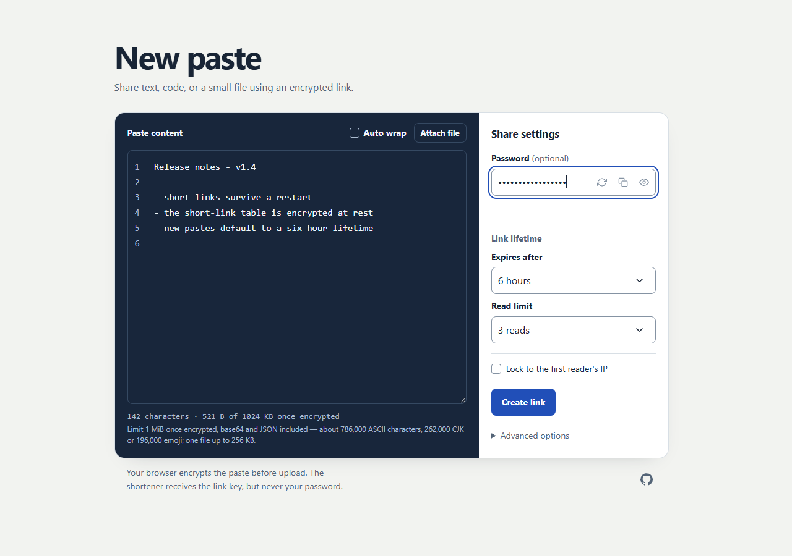
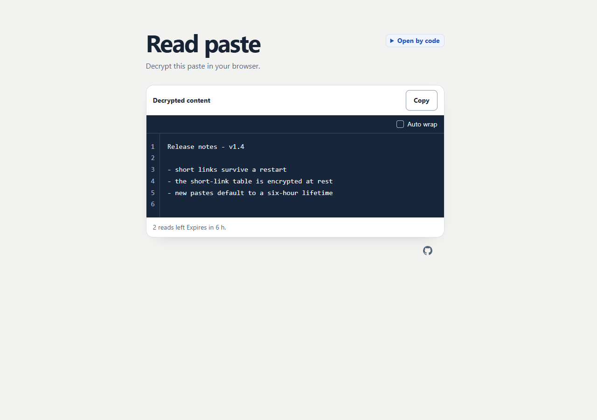

# Khepri

An encrypted paste. You type something, the browser encrypts it, and you get a
link. Whoever opens the link gets the text, or the one file you attached.

Running at https://paste.vantolab.com/.

## Screenshots





## What it does

- Text, or one file of up to 256 KB.
- Encrypted in the browser. The server keeps the ciphertext, a paste id and the
  limits you set.
- An optional password, so the link on its own is not enough.
- Read limits: once, three, five, or unlimited. "Once" deletes the paste when
  it is read.
- An optional lock to the first reader's IP.
- Short links (`/s/XXXXX`), because the long link is nearly 90 characters.

## How it works

The browser generates 32 random bytes, appends the password to them, and
derives the key with PBKDF2-SHA256 (1,000,000 rounds). The paste is encrypted
with AES-256-GCM, with the paste id as additional data. The key stays in the
link's fragment, which browsers do not send to servers.

Two processes: **core** keeps ciphertext in SQLite and hands it over once the
reader sends a token that only the key can produce; **shortener** maps short
codes to long links. The shortener has to see keys, so its table is encrypted
at rest under `SHORTENER_KEY`.

## Running it

```bash
# core
PORT=8080 TTL_HOURS=24 DB_PATH=./paste.db MAX_DISK_MB=5120 node src/core.js

# shortener — SHORTENER_KEY is required: 32 bytes as base64 or 64 hex characters
PORT=8081 PUBLIC_URL=https://paste.example.com/s ALLOWED_ORIGIN=https://paste.example.com \
  SHORTENER_KEY="$(openssl rand -base64 32)" node src/shortener.js
```

Point the core at the shortener with `SHORTENER_URL` to get short links.
`deploy/deploy.sh` builds the image, runs both containers and installs the
nginx vhost.

## Limits

1 MiB per request, 256 KB per file, 5 GiB and 200000 pastes on disk, 100000
short links. Per client: 2 MiB, 32 pastes, 200 live short codes. Rate limits
are 60 requests a minute on the core and 120 on the shortener. A paste lives
at most `TTL_HOURS` (24 by default, 168 in the deployment); the form starts at
six hours. Expired pastes are swept out every minute.

## Security notes

- A short link leads to the key. Anyone holding it can open the long link and
  read a paste that has no password; with a password they need that too, so
  make it strong — the key is derived from it, which is slow to guess.
- The core never sees a key, a password or plaintext. The shortener does see
  keys; its database is encrypted with `SHORTENER_KEY`, which stays on the host
  and never touches the data volume, so neither volume holds anything readable
  on its own.
- No accounts, no request logs, no backups. Everything expires.

## Layout

`src/` holds the two services and their shared helpers, `public/` the two
pages, `deploy/` the deployment script and nginx vhost, `assets/` the
screenshots above, `test/` the suite that runs with `node --test`.

## Not included

Read receipts, secret requests, a CLI, backups, link previews. None of them
earn their keep here.

MIT licensed.
